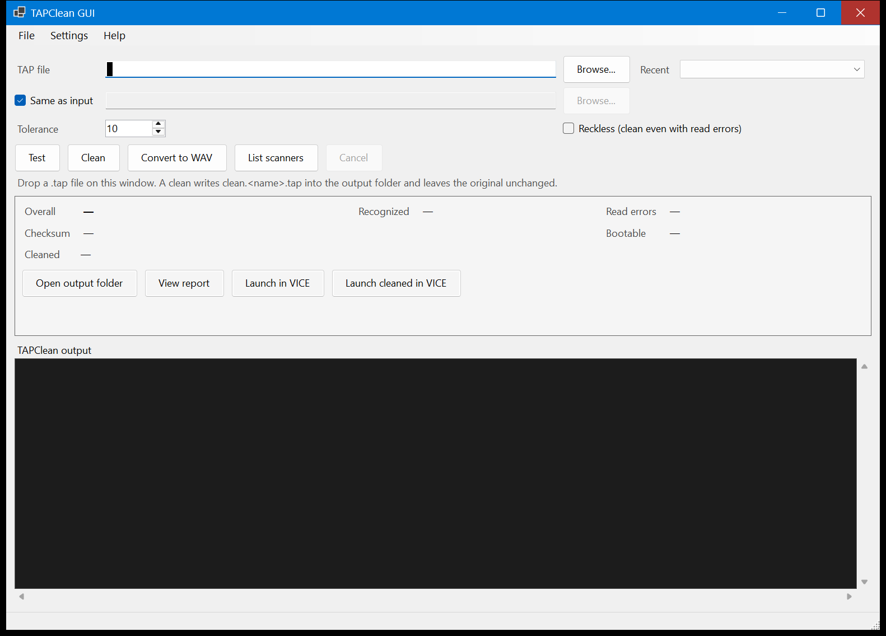

# TAPClean GUI

A quick, simple Windows GUI front end for [TAPClean](https://sourceforge.net/projects/tapclean/),
the Commodore 64 / VIC-20 `.tap` tape image tester and cleaner.

TAPClean GUI does not clean tapes itself. It runs your copy of `TAPClean.exe`,
shows its output, and makes the common jobs (test, clean, convert) a few clicks
instead of a command line.



## Please read first

- **Made with AI.** This tool was written by an AI coding assistant (xAI's Grok Build),
  driven and reviewed by an AI agent, with only minimal human testing.
- **As-is, no warranty, no support.** It is shared in case it is useful. There are no
  guarantees, and issues or pull requests may not be answered.
- **Unofficial.** It is not affiliated with or endorsed by the TC Team (TAPClean) or the
  VICE team.
- **Work on copies.** TAPClean leaves the original tape alone and writes a new
  `clean.<name>.tap`, but keep backups of anything you care about anyway.

## Features

- Pick a `.tap` file with Browse, drag and drop, or the recent files list.
- **Test** (`-t`), **Clean** (`-o`), **Convert to WAV** (`-wav`) and **List scanners** (`-list`).
- Options: read tolerance 0-15 (default 10), Reckless (clean despite read errors),
  output folder (default: same folder as the input tape).
- Runs TAPClean in the background with live output and a Cancel button. The window
  stays responsive.
- PASS/FAIL summary: overall result, recognised %, read errors, checksums, bootable,
  path of the cleaned file.
- Keeps TAPClean's report: `tcreport.txt` is copied next to the output as
  `<name>.tcreport.txt` and can be opened with **View report**.
- If TAPClean refuses to clean because of read errors, it explains why and suggests
  a higher tolerance or Reckless.
- **Open output folder**, and **Launch in VICE** for the original or cleaned tape
  (optional, needs VICE).
- Settings stored in `%APPDATA%\TAPCleanGUI\settings.json`.

## System requirements

- Windows 10 or 11, x64.
- [.NET 10 Desktop Runtime](https://dotnet.microsoft.com/download/dotnet/10.0) (x64).
  The release build is framework-dependent and will not start without it.
- TAPClean 0.38 for Windows (console build), downloaded separately from
  <https://sourceforge.net/projects/tapclean/files/>. It is **not** included here.
- Optional: [VICE](https://vice-emu.sourceforge.io/) (`x64sc.exe`) for the
  "Launch in VICE" buttons.

## Install (recommended)

1. Install the **.NET Desktop Runtime 10 (x64)** from Microsoft's official download page:
   <https://dotnet.microsoft.com/download/dotnet/10.0>.
2. Download TAPClean (for example `tapclean-0.38-win.zip`) from SourceForge and unzip it
   to a folder of your choice, e.g. `C:\Tools\TAPClean\`.
3. Download `TAPCleanGUI-1.0.0-win-x64.zip` from this repository's
   [Releases](../../releases) page and unzip it.
4. Easiest: put `TAPCleanGUI.exe` in the same folder as `TAPClean.exe`. The GUI looks
   there first, then on your `PATH`. Otherwise, set the path under **Settings**.
5. Optional: set the path to VICE's `x64sc.exe` in **Settings**.

No installer and no admin rights are needed. To uninstall, delete the exe and, if you
like, the `%APPDATA%\TAPCleanGUI` folder.

Windows SmartScreen may warn about an unsigned exe downloaded from the internet. If you
prefer, build it yourself from source (see below).

## Using it

1. Choose a `.tap` file (Browse, drag it onto the window, or pick from Recent).
2. Click **Test** to check it, or **Clean** to write `clean.<name>.tap` into the output
   folder.
3. Read the summary. Use **View report**, **Open output folder** or **Launch in VICE**
   as needed.
4. If a clean is refused because of read errors, try a higher tolerance (12-15) and test
   again. **Reckless** forces a cleaned file, but it may still not load.

Note: TAPClean always writes its report to `tcreport.txt` in its own folder, so that
folder must be writable, and you should only run one TAPClean job at a time.

## Building from source

Requires the .NET 10 SDK on Windows.

```
dotnet build TAPCleanGUI.sln
dotnet publish src/TAPCleanGui -c Release -r win-x64 --self-contained false -p:PublishSingleFile=true -o publish
```

The result is `publish\TAPCleanGUI.exe`.

Layout:

- `src/TAPCleanGui.Core` - runs TAPClean, parses its output, settings (no UI).
- `src/TAPCleanGui` - the Windows Forms app.
- `tests/TAPCleanGui.Tests` - a small console test program.

### Tests

```
dotnet run --project tests/TAPCleanGui.Tests
```

Unit tests always run. Integration tests run TAPClean on your own tape images, on
temporary copies, and are skipped unless you provide them (no tape images are included
in this repository):

| Environment variable | Argument | Meaning |
| --- | --- | --- |
| `TAPCLEAN_GUI_TAPCLEAN_EXE` | `--tapclean <path>` | Path to `TAPClean.exe` (otherwise auto-detected) |
| `TAPCLEAN_GUI_GOOD_TAP` | `--good <path>` | A tape that tests PASS and can be cleaned |
| `TAPCLEAN_GUI_BAD_TAP` | `--bad <path>` | A tape with read errors that TAPClean refuses to clean |

## License and attribution

TAPClean GUI is licensed under the **GNU General Public License v2.0 or later**
(`GPL-2.0-or-later`), the same terms as TAPClean. See [LICENSE](LICENSE) and
[NOTICE.md](NOTICE.md).

- TAPClean (C) 2006-2019 TC Team, based on Final TAP (C) 2001-2006 Subchrist Software,
  GPL v2 or later: <https://sourceforge.net/projects/tapclean/>
- VICE is a separate, optional program by the VICE team: <https://vice-emu.sourceforge.io/>

This project contains no TAPClean or VICE code or binaries, and no tape images.

## Disclaimer

THIS SOFTWARE IS PROVIDED "AS IS", WITHOUT WARRANTY OF ANY KIND. It is unofficial and
unsupported. Use it at your own risk and keep backups of your tape images.
